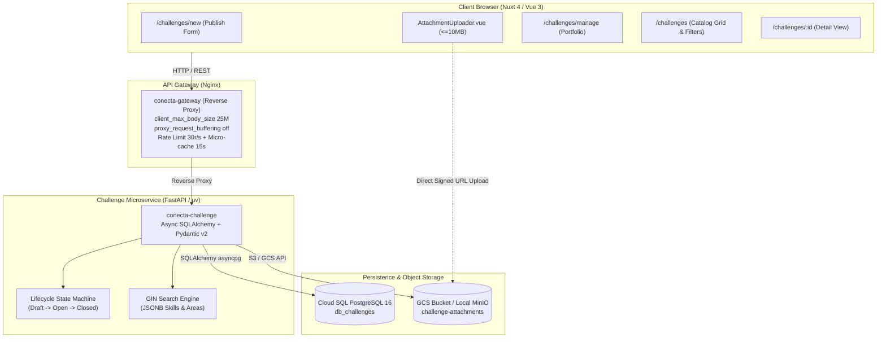

# Conecta Nexus — Sprint 2 Full Engineering Tasks Plan (Ecosystem-Wide)

## 1. Overview
- **Sprint Name:** Sprint 2 (Milestone 1: 66% System Progress)
- **Timeframe:** October 23, 2026 – November 11, 2026 (20 days)
- **Target Repositories & Services:**
  1. [`conecta-nexus/challenge`](https://github.com/conecta-nexus/challenge): FastAPI + SQLAlchemy Async + PostgreSQL 16 (`db_challenges`).
  2. [`conecta-nexus/frontend`](https://github.com/conecta-nexus/frontend): Nuxt 4 (Vue 3, `@nuxt/ui` v4, Tailwind CSS, TypeScript).
  3. [`conecta-nexus/infra`](https://github.com/conecta-nexus/infra): Google Cloud Platform Terraform (Cloud Run, Cloud Storage, Cloud SQL) & local Docker/Podman Compose.
  4. [`conecta-nexus/gateway`](https://github.com/conecta-nexus/gateway): Nginx Reverse Proxy / API Gateway (streaming, caching, rate limiting).
- **Parent User Stories:** 5 Stories (`HU-06`, `HU-07`, `HU-08`, `HU-09`, `HU-10`)
- **Total Story Points:** 33 Story Points
- **Total Granular Tasks:** **30 Engineering Tasks**
  - **Backend (`challenge`):** 14 Tasks
  - **Frontend (`frontend`):** 10 Tasks
  - **Infrastructure (`infra`):** 4 Tasks
  - **API Gateway (`gateway`):** 2 Tasks

---

## 2. Infrastructure & Gateway Architectural Rationale

1. **Cloud Run Provisioning for Challenge Service (`infra/cloud_run.tf`):**
   Prior to Sprint 2, Terraform only provisioned `auth`, `profile`, `frontend`, and `gateway`. Deploying and linking `challenge` to Cloud SQL `db_challenges` and VPC access requires dedicated infrastructure resources.
2. **Object Storage for Attachments (`infra/storage.tf` & `compose.yaml`):**
   `HU-07` introduces technical file attachments ($\le 10\text{MB}$ PDFs/images). This requires a Google Cloud Storage bucket (`google_storage_bucket`) with CORS policies and Cloud Run IAM bindings in GCP, plus local S3-compatible MinIO in `compose.yaml` for offline development.
3. **Gateway Multipart Streaming Optimization (`gateway/conf.d/default.conf`):**
   Streaming 10MB attachments through Nginx requires turning request buffering off (`proxy_request_buffering off;`) to stream directly to FastAPI without memory spikes or timeouts, while exposing download headers (`Content-Disposition`).
4. **Catalog Caching & Route Protection (`gateway`):**
   Public opportunity discovery (`HU-09`) introduces heavy read traffic. A 15-second micro-cache and 30 req/s rate-limiting protect backend services from denial-of-service spikes.

---

## 3. Workload Balance Between Developers (10 Tasks Each)

> [!NOTE]
> Per project governance, **all infrastructure (`infra`) and API gateway (`gateway`) tasks are strictly divided between Nelson Conde and Anorak**. Juan Diego focuses 100% on core application engineering (5 backend tasks in `challenge` and 5 frontend tasks in `frontend`).

```
Sprint 2 Developer Workload Balance (30 Tasks Total)
├── Juan Diego (@juandiegosb)   : 10 Tasks (5 Backend + 5 Frontend + 0 Infra + 0 Gateway)
├── Nelson Conde (@NelsonConde)  : 10 Tasks (4 Backend + 3 Frontend + 2 Infra + 1 Gateway)
└── Anorak (@AnorakTeam)        : 10 Tasks (5 Backend + 2 Frontend + 2 Infra + 1 Gateway)
```

| Developer | Backend (`challenge`) | Frontend (`frontend`) | Infrastructure (`infra`) | API Gateway (`gateway`) | Total Tasks | Primary Architectural Domain |
| :--- | :---: | :---: | :---: | :---: | :---: | :--- |
| **Juan Diego (`@juandiegosb`)** | 5 tasks | 5 tasks | **0 tasks** | **0 tasks** | **10** | **Application Architecture & Full-Stack UI:**<br>• Attachment upload/download endpoints & MinIO integration.<br>• Attachment uploader UI & signed preview/download components.<br>• Lifecycle state machine & voluntary closure endpoints/modal.<br>• Company challenge management dashboard page (`/challenges/manage`).<br>• Public catalog masking serializers, catalog exploration endpoints & detail view. |
| **Nelson Conde (`@NelsonConde`)** | 4 tasks | 3 tasks | 2 tasks | 1 task | **10** | **Core Backend Models, Infrastructure & Gateway Streaming:**<br>• Database engine & connection configuration.<br>• Challenge SQLAlchemy model, Alembic migrations & Pydantic schemas.<br>• Cloud Run Terraform provisioning (`infra/cloud_run.tf`).<br>• MinIO container setup in `compose.yaml`.<br>• Gateway 10MB attachment streaming optimization (`proxy_request_buffering off;`).<br>• Challenge creation form page (`/challenges/new`), catalog cards grid (`/challenges`) & empty-state view. |
| **Anorak (`@AnorakTeam`)** | 5 tasks | 2 tasks | 2 tasks | 1 task | **10** | **Security, Search Engine, Cloud Storage & Database Tuning:**<br>• Stateless RS256 JWT security & scope RBAC verification (ADR-002).<br>• Challenge publication & company ownership enforcement (`403` check).<br>• GIN indexes for JSONB arrays & reactive query builder.<br>• Reactive filter bar component & URL query synchronization.<br>• Google Cloud Storage bucket Terraform provisioning (`infra/storage.tf`).<br>• Cloud SQL database tuning & Gateway catalog micro-caching (15s). |

---

## 4. End-to-End System Architecture



---

## 5. Complete Inventory of the 30 Sprint 2 Tasks

### `HU-06`: Business Need and Challenge Publication (8 pts - Must Have)

| Task ID | Repo | Assignee | Title | Key Technical Specs & Deliverables | Verification Command |
| :--- | :---: | :---: | :--- | :--- | :--- |
| **`CHALLENGE-TASK-01`** | `challenge` | `@NelsonConde` | Database Engine & Connection Configuration | Async SQLAlchemy engine (`asyncpg`) for `db_challenges`, pool size 10, max overflow 20, `pydantic-settings` BaseSettings, `get_db` FastAPI dependency. | `uv run python -c 'from src.core.database import async_engine; print(async_engine)'` |
| **`CHALLENGE-TASK-02`** | `challenge` | `@AnorakTeam` | Stateless RS256 JWT Authentication & Scopes RBAC (ADR-002) | Stateless RS256 verification with RSA public key (`jwt_public.pem`), extracting `sub`, `role` (`COMPANY`, `STUDENT`, `ADMIN`), and OAuth2 scopes. | `uv run pytest tests/test_security.py` |
| **`CHALLENGE-TASK-03`** | `challenge` | `@NelsonConde` | Challenge Database Model & PostgreSQL Constraints | `challenges` model in `db_challenges`: status enum (`DRAFT`, `OPEN`, `IN_PROGRESS`, `CLOSED`, `CANCELLED`), JSONB skills, semester check (6–10), Alembic migrations. | `uv run alembic upgrade head` |
| **`CHALLENGE-TASK-04`** | `challenge` | `@NelsonConde` | Challenge Pydantic v2 Schemas & Repository | `ChallengeCreate`, `ChallengeUpdate`, `ChallengeResponse` Pydantic schemas and async `ChallengeRepository` database operations. | `uv run pytest tests/test_challenge_repository.py` |
| **`CHALLENGE-TASK-05`** | `challenge` | `@AnorakTeam` | Challenge Publication & Ownership Protection Endpoint | `POST /api/v1/challenges/` and `PATCH /api/v1/challenges/{id}`, enforcing company ownership (`403 Forbidden` on mismatch) and editable state restrictions (`DRAFT`/`OPEN`). | `uv run pytest tests/test_challenge_endpoints.py` |
| **`FRONTEND-TASK-01`** | `frontend` | `@AnorakTeam` | Challenge TypeScript Interfaces & useChallenges Composable | `app/types/challenge.ts` models and `app/composables/useChallenges.ts` wrapping `useApi()` for reactive challenge creation, updates, and portfolio fetching. | `cd frontend && pnpm lint` |
| **`FRONTEND-TASK-02`** | `frontend` | `@NelsonConde` | Company Challenge Creation Form Page (`/challenges/new`) | Nuxt page `challenges/new.vue` with company role guard, Tiptap markdown editor, skills tag chips selector, and publication action triggers. | `cd frontend && pnpm lint` |
| **`INFRA-TASK-01`** | `infra` | `@NelsonConde` | Cloud Run Terraform Provisioning for Challenge Service | `google_cloud_run_v2_service.challenge` in `infra/cloud_run.tf` with Cloud SQL connection, VPC access, autoscaling (0-5), and invoker IAM. | `cd infra && terraform validate` |

---

### `HU-07`: Secure Technical Attachment Management (5 pts - Should Have)

| Task ID | Repo | Assignee | Title | Key Technical Specs & Deliverables | Verification Command |
| :--- | :---: | :---: | :--- | :--- | :--- |
| **`CHALLENGE-TASK-06`** | `challenge` | `@juandiegosb` | Object Storage Client & Storage Service (MinIO/GCS) | MinIO/GCS S3 client integration, bucket `challenge-attachments`, chunked streaming upload, and 1-hour ephemeral signed download URL generator. | `uv run pytest tests/test_storage_service.py` |
| **`CHALLENGE-TASK-07`** | `challenge` | `@NelsonConde` | Attachment Database Model & Storage Migrations | `challenge_attachments` table in `db_challenges`: CASCADE delete, CHECK `file_size_bytes <= 10485760` (10MB), allowed MIME checks, Alembic migration. | `uv run alembic upgrade head` |
| **`CHALLENGE-TASK-08`** | `challenge` | `@juandiegosb` | Attachment Upload & Signed Download Endpoints | `POST /api/v1/challenges/{id}/attachments` validating max size 10MB (`HTTP 413`) and allowed MIME formats (`HTTP 415`), alongside signed URL download endpoint. | `uv run pytest tests/test_attachment_upload.py` |
| **`FRONTEND-TASK-03`** | `frontend` | `@juandiegosb` | Drag-and-Drop Attachment Uploader Component | `app/components/challenges/AttachmentUploader.vue` with drag-and-drop zone, client-side 10MB limit enforcement, format restriction, and progress bar. | `cd frontend && pnpm lint` |
| **`FRONTEND-TASK-04`** | `frontend` | `@juandiegosb` | Attachment Download & Ephemeral Link Preview Component | `app/components/challenges/AttachmentList.vue` displaying MIME icons, human-readable file sizes, signed download openers, and owner delete actions. | `cd frontend && pnpm lint` |
| **`INFRA-TASK-02`** | `infra` | `@AnorakTeam` | Cloud Storage Bucket & IAM Binding for Technical Attachments | Terraform resource `google_storage_bucket.challenge_attachments` with CORS rules, lifecycle management, and `roles/storage.objectAdmin` binding. | `cd infra && terraform validate` |
| **`INFRA-TASK-03`** | `infra` | `@NelsonConde` | MinIO Object Storage Setup for Local Containerized Environment | Configure MinIO S3 service and `minio-init` bucket initialization in `compose.yaml` with healthchecks for offline developer environments. | `podman compose config || docker compose config` |
| **`GATEWAY-TASK-01`** | `gateway` | `@NelsonConde` | Large Attachment Streaming & Proxy Buffering Optimization | Configure `proxy_request_buffering off;`, extended timeouts (120s), and CORS exposed headers (`Content-Disposition`) for 10MB file streaming. | `docker run --rm -v $(pwd)/gateway/conf.d:/etc/nginx/conf.d:ro nginx:alpine nginx -t 2>/dev/null || true` |

---

### `HU-08`: Own Challenge Administration and Voluntary Closure (5 pts - Should Have)

| Task ID | Repo | Assignee | Title | Key Technical Specs & Deliverables | Verification Command |
| :--- | :---: | :---: | :--- | :--- | :--- |
| **`CHALLENGE-TASK-09`** | `challenge` | `@juandiegosb` | Challenge Lifecycle State Machine & Justification Model | `challenge_closure_logs` model and lifecycle state validator (`DRAFT` $\rightarrow$ `OPEN` $\rightarrow$ `IN_PROGRESS` / `CLOSED` / `CANCELLED`), auditing voluntary closures. | `uv run alembic upgrade head` |
| **`CHALLENGE-TASK-10`** | `challenge` | `@AnorakTeam` | Voluntary Closure & Company Dashboard Endpoints | `POST /api/v1/challenges/{id}/close` requiring mandatory reason ($\ge 15$ chars), `POST /publish`, and `GET /company/me` paginated portfolio endpoint. | `uv run pytest tests/test_challenge_closure.py` |
| **`FRONTEND-TASK-05`** | `frontend` | `@juandiegosb` | Company Challenge Management Dashboard Page (`/challenges/manage`) | Nuxt page `challenges/manage.vue` with status tabs (`Draft`, `Open`, `In Progress`, `Closed`), overview metrics counters, and interactive actions table. | `cd frontend && pnpm lint` |
| **`FRONTEND-TASK-06`** | `frontend` | `@juandiegosb` | Voluntary Closure Modal with Mandatory Justification | `app/components/challenges/ChallengeClosureModal.vue` with live character counter, disabling confirmation until justification $\ge 15$ chars. | `cd frontend && pnpm lint` |

---

### `HU-09`: Open Opportunity Catalog Exploration (8 pts - Must Have)

| Task ID | Repo | Assignee | Title | Key Technical Specs & Deliverables | Verification Command |
| :--- | :---: | :---: | :--- | :--- | :--- |
| **`CHALLENGE-TASK-11`** | `challenge` | `@juandiegosb` | Public Catalog Query Service & Data Masking Serializers | Pydantic serializers strictly masking direct company email/phone per RB-05 / RF08, providing discovery card summaries. | `uv run pytest tests/test_catalog_schemas.py` |
| **`CHALLENGE-TASK-12`** | `challenge` | `@juandiegosb` | Public Catalog Exploration & Detail View Endpoints | `GET /api/v1/challenges/catalog` returning active challenges (`status == 'OPEN'`) with pagination metadata, and public challenge detail view route. | `uv run pytest tests/test_catalog_endpoint.py` |
| **`FRONTEND-TASK-07`** | `frontend` | `@NelsonConde` | Opportunity Catalog Grid & Discovery Cards (`/challenges`) | Nuxt page `challenges/index.vue` with responsive grid of `ChallengeCard.vue` (badges, skills pills, modality, semester requirement) and pagination. | `cd frontend && pnpm lint` |
| **`FRONTEND-TASK-08`** | `frontend` | `@juandiegosb` | Public Challenge Detail Page with Masked Contacts (`/challenges/[id]`) | Dynamic page `challenges/[id].vue` rendering complete problem statement, attachments with signed download links, masked contacts, and "Apply" CTA. | `cd frontend && pnpm lint` |
| **`GATEWAY-TASK-02`** | `gateway` | `@AnorakTeam` | Catalog Micro-Caching & Public Route Rate Limiting | 15-second micro-cache on public anonymous `GET /api/v1/challenges/catalog`, cache bypass for authenticated headers, and 30 req/s rate-limiting. | `docker run --rm -v $(pwd)/gateway/conf.d:/etc/nginx/conf.d:ro nginx:alpine nginx -t 2>/dev/null || true` |

---

### `HU-10`: Reactive Multi-Criteria Filtering (7 pts - Should Have)

| Task ID | Repo | Assignee | Title | Key Technical Specs & Deliverables | Verification Command |
| :--- | :---: | :---: | :--- | :--- | :--- |
| **`CHALLENGE-TASK-13`** | `challenge` | `@AnorakTeam` | GIN Indexes & Multi-Criteria SQL Query Repository | PostgreSQL GIN indexes on `required_skills` and `knowledge_areas` JSONB columns, B-Tree indexes, and dynamic SQLAlchemy filter query builder. | `uv run alembic upgrade head` |
| **`CHALLENGE-TASK-14`** | `challenge` | `@AnorakTeam` | Reactive Filtering Endpoint & Empty-State Metadata | Multi-param catalog query filters (`knowledge_area`, `skill`, `sector`, `modality`, `difficulty`, `q`) and structured empty-state metadata when 0 matches occur. | `uv run pytest tests/test_catalog_filtering.py` |
| **`FRONTEND-TASK-09`** | `frontend` | `@AnorakTeam` | Reactive Filter Bar Component & URL Query Sync | `app/components/challenges/CatalogFilterBar.vue` with debounced search, dropdown selects, and bidirectional Nuxt router query synchronization. | `cd frontend && pnpm lint` |
| **`FRONTEND-TASK-10`** | `frontend` | `@NelsonConde` | Filter Empty-State View & Reset Action Component | `app/components/challenges/CatalogEmptyState.vue` displaying zero-result messaging, active filter chips, and one-click "Reset All Filters" action. | `cd frontend && pnpm lint` |
| **`INFRA-TASK-04`** | `infra` | `@AnorakTeam` | Cloud SQL Database & Performance Optimization for db_challenges | Verify and configure PostgreSQL 16 database flags (`max_connections`, `shared_buffers`, `work_mem`) in `infra/cloud_sql.tf` for fast JSONB querying. | `cd infra && terraform validate` |

---

## 6. How to Run & Verify

- **Regenerate / Verify CSV:**
  ```bash
  python3 sprints/sprint-2/create_sprint2_tasks_csv.py
  ```
- **Import all 30 tasks to GitHub and Project #2:**
  ```bash
  sprints/sprint-2/import_sprint_2_tasks.sh
  ```
  *(or `python3 sprints/sprint-2/import_sprint_2_tasks.py`)*
