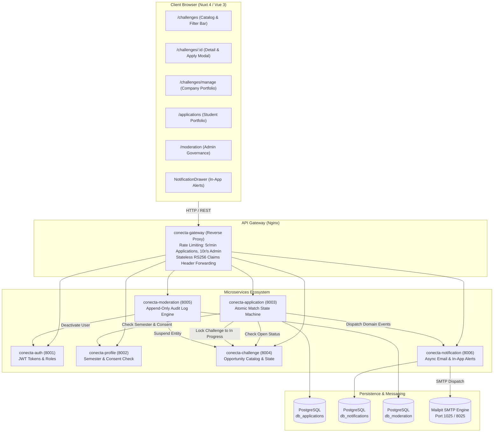

# Conecta Nexus — Sprint 3 Full Engineering Tasks Plan (Ecosystem-Wide)

## 1. Overview
- **Sprint Name:** Sprint 3 (Milestone 2: 100% MVP Completion)
- **Timeframe:** November 12, 2026 – December 02, 2026 (21 days)
- **Target Repositories & Microservices:**
  1. [`conecta-nexus/application`](https://github.com/conecta-nexus/application): Django 6.1 + Django REST Framework + PostgreSQL 16 (`db_applications`).
  2. [`conecta-nexus/notification`](https://github.com/conecta-nexus/notification): FastAPI + SQLAlchemy Async + aiosmtplib + Mailpit / Cloud SMTP (`db_notifications`).
  3. [`conecta-nexus/moderation`](https://github.com/conecta-nexus/moderation): Django 6.1 + DRF + Append-Only Audit Logging (`db_moderation`).
  4. [`conecta-nexus/frontend`](https://github.com/conecta-nexus/frontend): Nuxt 4 (Vue 3, `@nuxt/ui` v4, Tailwind CSS, TypeScript).
  5. [`conecta-nexus/gateway`](https://github.com/conecta-nexus/gateway): Nginx Reverse Proxy / API Gateway (Rate limiting, WebSocket/SSE support, route security).
  6. [`conecta-nexus/infra`](https://github.com/conecta-nexus/infra): Google Cloud Platform Terraform (Cloud Run, Cloud SQL, Secret Manager) & local Podman/Docker Compose.
- **Parent User Stories:**
  - `HU-11`: `[APPLICATION] HU-11: Submit Contact Application with Motivation Letter` (8 Story Points, Must Have)
  - `HU-12`: `[APPLICATION] HU-12: Company Evaluation and Atomic State Transition` (10 Story Points, Must Have)
  - `HU-13`: `[NOTIFICATION] HU-13: Asynchronous Domain Alerts and SMTP Emailing` (8 Story Points, Should Have)
  - `HU-14`: `[MODERATION] HU-14: Platform Governance and Institutional Audit Log` (8 Story Points, Should Have)
  - **Reopened Sprint 2 Frontend Scope:** `HU-06`, `HU-07`, `HU-08`, `HU-09`, `HU-10` (Refactoring & quality hardening)
- **Total Story Points:** 34 Story Points (+ Reopened Frontend Quality Scope)
- **Total Granular Tasks:** **39 Engineering Tasks**
  - **Reopened Sprint 2 Frontend (`frontend`):** 10 Tasks
  - **Application Service (`application`):** 8 Tasks
  - **Notification Service (`notification`):** 5 Tasks
  - **Moderation Service (`moderation`):** 5 Tasks
  - **New Sprint 3 Frontend Features (`frontend`):** 6 Tasks
  - **API Gateway (`gateway`):** 2 Tasks
  - **Infrastructure (`infra`):** 3 Tasks

---

## 2. Architectural Rationale & Decisions

### 1. Reopening Sprint 2 Frontend Tasks for Quality Hardening
The frontend tasks implemented during Sprint 2 suffered from critical usability, visual, and behavioral deficiencies (missing inline validation states, no live character counters, unhandled network timeouts, lack of responsive mobile layouts, and missing disabled state tooltips). Reopening these 10 tasks ensures the user interface attains production-grade polish with explicit visual and interaction acceptance criteria before final release.

### 2. Atomic Match Locking & Reciprocal Contact Reveal (`HU-11`, `HU-12`)
- **Rule RB-03 (Single Active Application):** The `(student_id, challenge_id)` unique constraint in PostgreSQL guarantees students cannot submit duplicate applications.
- **Rule RB-04 (Atomic Challenge Lock):** Accepting a student application switches the challenge status to `IN_PROGRESS` inside a database transaction (`select_for_update()`), freezing other pending proposals.
- **Rule RB-05 (Reciprocal Contact Reveal):** Under Colombian Law 1581 (Habeas Data), corporate and student contact info (direct corporate email, phone, student contact details) are masked during catalog browsing and only unmasked mutually once an application is accepted.

### 3. Asynchronous Alerts & SMTP Engine (`HU-13`)
Transactional domain events (`ApplicationCreated`, `ApplicationAccepted`, `ApplicationRejected`) trigger asynchronous emails. The Notification microservice connects to local **Mailpit** (`localhost:1025` SMTP, `localhost:8025` Web UI) for local testing and Google Cloud SMTP in production with exponential backoff retries and Jinja2 responsive HTML templates.

### 4. Append-Only Institutional Governance & Immutability (`HU-14`)
The Moderation microservice enforces an append-only audit trail. `AuditLog` records cannot be updated or deleted, guaranteeing institutional traceability for challenge suspensions, user deactivations, and policy enforcement.

---

## 3. Workload Balance Between Developers (13 Tasks Each)

Tasks are distributed equitably across the 3 developers (exactly 13 tasks each), aligning with project governance and domain expertise:

```
Sprint 3 Developer Workload Distribution (39 Tasks Total)
├── Juan Diego (@juandiegosb)   : 13 Tasks (4 Reopened Frontend + 6 Application Backend + 3 New Frontend)
├── Nelson Conde (@NelsonConde)  : 13 Tasks (4 Reopened Frontend + 5 Notification Backend + 3 Moderation Backend + 1 New Frontend)
└── Anorak (@AnorakTeam)        : 13 Tasks (2 Reopened Frontend + 2 Application Backend + 2 Moderation Backend + 2 New Frontend + 2 Gateway + 3 Infra)
```

| Developer | Reopened Frontend | Backend Services | New Frontend | Infra & Gateway | Total Tasks | Primary Responsibility |
| :--- | :---: | :---: | :---: | :---: | :---: | :--- |
| **Juan Diego (`@juandiegosb`)** | 4 tasks | 6 tasks (`application`) | 3 tasks | **0 tasks** | **13** | **Application Workflows & Core Candidate UI:**<br>• Attachment Uploader & List UI refactoring.<br>• Company dashboard & voluntary closure modal overhaul.<br>• Application model, submission, and rejection endpoints.<br>• Student application submission modal & review drawers. |
| **Nelson Conde (`@NelsonConde`)** | 4 tasks | 8 tasks (`notification`, `moderation`) | 1 task | **0 tasks** | **13** | **Notification Engine, Moderation & Public Catalog UI:**<br>• Challenge creation form, catalog grid, detail view, empty state refactoring.<br>• Notification engine, HTML email templates, and in-app alert storage.<br>• Moderation database models & custom Django Admin.<br>• In-app notification bell & drawer component. |
| **Anorak (`@AnorakTeam`)** | 2 tasks | 4 tasks (`application`, `moderation`) | 2 tasks | 5 tasks (`infra`, `gateway`) | **13** | **System Architecture, Security, Cloud Infra & Match Engine:**<br>• Interfaces, useChallenges composable, reactive filter bar.<br>• Inter-service verification clients & atomic acceptance lock state machine.<br>• Inter-service suspension webhooks & moderation audit test suites.<br>• Reciprocal contact reveal & admin governance frontend.<br>• Nginx rate limiting & Cloud Run/Cloud SQL Terraform provisioning. |

---

## 4. End-to-End System Architecture



---

## 5. Master Inventory of All 39 Tasks

### 5.1. Reopened Sprint 2 Frontend Quality Tasks (10 Tasks)

| Task ID | Repo | Assignee | Parent Story | Title | Key Technical Specs | Verification Command |
| :--- | :---: | :---: | :---: | :--- | :--- | :--- |
| **`FRONTEND-TASK-01-R`** | `frontend` | `@AnorakTeam` | `HU-06` | Reopen: Harden Challenge TypeScript Interfaces & useChallenges Composable | `app/types/challenge.ts`, `app/composables/useChallenges.ts`, strict typing, cache invalidation, normalized error handling. | `cd frontend && pnpm test tests/composables/useChallenges.spec.ts` |
| **`FRONTEND-TASK-02-R`** | `frontend` | `@NelsonConde` | `HU-06` | Reopen: Redesign Company Challenge Creation Page (`/challenges/new`) | 2-column layout, real-time red borders on dirty fields, description char counter (30 min), tag chips input, disabled button guard. | `cd frontend && pnpm test tests/pages/challenges/new.spec.ts` |
| **`FRONTEND-TASK-03-R`** | `frontend` | `@juandiegosb` | `HU-07` | Reopen: Redesign Drag-and-Drop Attachment Uploader (`AttachmentUploader.vue`) | Pulsing drop zone, instant client-side 10MB/MIME rejection banner, per-file progress bar, success checkmark reset. | `cd frontend && pnpm test tests/components/challenges/AttachmentUploader.spec.ts` |
| **`FRONTEND-TASK-04-R`** | `frontend` | `@juandiegosb` | `HU-07` | Reopen: Redesign Attachment List & Ephemeral Preview (`AttachmentList.vue`) | Red PDF & blue image badges, human byte sizes, signed URL opener in new tab, deletion confirmation popover dialog. | `cd frontend && pnpm test tests/components/challenges/AttachmentList.spec.ts` |
| **`FRONTEND-TASK-05-R`** | `frontend` | `@juandiegosb` | `HU-08` | Reopen: Overhaul Company Challenge Management Dashboard (`/challenges/manage`) | 4 overview stat cards, status tabs with badge counts, responsive table, 3-dot contextual action menu, empty-state CTA button. | `cd frontend && pnpm test tests/pages/challenges/manage.spec.ts` |
| **`FRONTEND-TASK-06-R`** | `frontend` | `@juandiegosb` | `HU-08` | Reopen: Redesign Voluntary Closure Modal with Strict Guard (`ChallengeClosureModal.vue`) | Amber warning banner, dynamic 15-char counter, button strictly disabled until 15 chars, spinner on submit. | `cd frontend && pnpm test tests/components/challenges/ChallengeClosureModal.spec.ts` |
| **`FRONTEND-TASK-07-R`** | `frontend` | `@NelsonConde` | `HU-09` | Reopen: Redesign Opportunity Catalog Grid & Discovery Cards (`/challenges`) | Animated skeleton loading cards, color-coded modality & difficulty badges, hover lift effect, bottom paginator bar. | `cd frontend && pnpm test tests/pages/challenges/index.spec.ts` |
| **`FRONTEND-TASK-08-R`** | `frontend` | `@NelsonConde` | `HU-09` | Reopen: Redesign Public Challenge Detail Page with Masked Contacts (`/challenges/[id]`) | Hero header, 2-column layout, contact masking privacy card (Law 1581), role-aware 'Apply' CTA button, 404 state. | `cd frontend && pnpm test tests/pages/challenges/detail.spec.ts` |
| **`FRONTEND-TASK-09-R`** | `frontend` | `@AnorakTeam` | `HU-10` | Reopen: Polish Reactive Catalog Filter Bar with URL Sync (`CatalogFilterBar.vue`) | Debounced search (300ms) with 'x' clear, dropdown selects, active filter pill chips with single-click removal, URL query sync. | `cd frontend && pnpm test tests/components/challenges/CatalogFilterBar.spec.ts` |
| **`FRONTEND-TASK-10-R`** | `frontend` | `@NelsonConde` | `HU-10` | Reopen: Enhance Catalog Empty-State View & Reset Action (`CatalogEmptyState.vue`) | Illustrated empty-state icon, contextual filter feedback, prominent 'Clear All Filters' button, secondary explore link. | `cd frontend && pnpm test tests/components/challenges/CatalogEmptyState.spec.ts` |

---

### 5.2. Application Microservice Tasks (8 Tasks — `HU-11` & `HU-12`)

| Task ID | Repo | Assignee | Parent Story | Title | Key Technical Specs | Verification Command |
| :--- | :---: | :---: | :---: | :--- | :--- | :--- |
| **`APPLICATION-TASK-01`** | `application` | `@juandiegosb` | `HU-11` | Application Database Model, PostgreSQL Constraints & Migrations | Django model `Application`, unique constraint on `(student_id, challenge_id)` (RB-03), status enum, indexes, migrations. | `podman exec conecta-application python manage.py migrate` |
| **`APPLICATION-TASK-02`** | `application` | `@AnorakTeam` | `HU-11` | Inter-Service Synchronous Verification Clients (Profile & Challenge) | `ProfileServiceClient` (semester 6-10 & consent) and `ChallengeServiceClient` (catalog open check), timeout & error mapping to 502. | `podman exec conecta-application uv run pytest apps/applications/tests/test_challenge_client.py apps/applications/tests/test_profile_client.py` |
| **`APPLICATION-TASK-03`** | `application` | `@juandiegosb` | `HU-11` | Student Application Submission REST Endpoint (`POST /api/v1/applications/`) | DRF view with STUDENT RBAC, non-duplicity fast check (409), inter-service pipeline, and atomic persistence (201). | `podman exec conecta-application uv run pytest apps/applications/tests/test_views.py` |
| **`APPLICATION-TASK-04`** | `application` | `@juandiegosb` | `HU-11` | Student Applications Consultation Endpoints (`GET /me/` & `GET /{id}/`) | Student portfolio listing, owner access isolation, conditional contact/feedback projection based on status. | `podman exec conecta-application uv run pytest -k 'student_applications'` |
| **`APPLICATION-TASK-05`** | `application` | `@juandiegosb` | `HU-12` | Company Challenge Applications Listing & Detail Endpoints (`GET /challenge/{id}/`) | Company candidate review listing, challenge ownership enforcement, student profile projection with masked contacts. | `podman exec conecta-application uv run pytest -k 'company_applications'` |
| **`APPLICATION-TASK-06`** | `application` | `@AnorakTeam` | `HU-12` | Atomic Application Acceptance & Challenge Locking State Machine (RB-04, RB-05) | `POST /{id}/accept/`, `transaction.atomic()`, `select_for_update()`, atomic lock to IN_PROGRESS, reciprocal contact reveal. | `podman exec conecta-application uv run pytest -k 'test_accept_application'` |
| **`APPLICATION-TASK-07`** | `application` | `@juandiegosb` | `HU-12` | Application Rejection with Mandatory Explanation Endpoint (`POST /{id}/reject/`) | Mandatory explanation validation ($\ge 15$ chars), status transition to REJECTED, challenge remains strictly OPEN. | `podman exec conecta-application uv run pytest -k 'test_reject_application'` |
| **`APPLICATION-TASK-08`** | `application` | `@juandiegosb` | `HU-12` | Complete Integration Test Suite for Application Service | Pytest suite covering submission, duplicity rejection, semester checks, atomic locks, feedback, and coverage $\ge 85\%$. | `podman exec conecta-application uv run pytest --cov=apps/applications` |

---

### 5.3. Notification Microservice Tasks (5 Tasks — `HU-13`)

| Task ID | Repo | Assignee | Parent Story | Title | Key Technical Specs | Verification Command |
| :--- | :---: | :---: | :---: | :--- | :--- | :--- |
| **`NOTIFICATION-TASK-01`** | `notification` | `@NelsonConde` | `HU-13` | Notification Service FastEngine, Asyncpg & Event Dispatcher | FastAPI engine, asyncpg connection pool to `db_notifications`, RS256 public key authentication, `/health` endpoint. | `podman exec conecta-notification uv run python -c 'import src.main; print(\"OK\")'` |
| **`NOTIFICATION-TASK-02`** | `notification` | `@NelsonConde` | `HU-13` | Transactional HTML Email Templates & Mailpit/SMTP Engine | Responsive Jinja2 email templates (Created, Accepted, Rejected), `aiosmtplib` client with retry backoff and Mailpit connection. | `podman exec conecta-notification uv run pytest tests/test_email_service.py` |
| **`NOTIFICATION-TASK-03`** | `notification` | `@NelsonConde` | `HU-13` | In-App Notification Center Model & Storage | SQLAlchemy model `Notification` in `db_notifications`, B-Tree index on `(user_id, is_read, created_at)`, Alembic migrations. | `podman exec conecta-notification uv run alembic upgrade head` |
| **`NOTIFICATION-TASK-04`** | `notification` | `@NelsonConde` | `HU-13` | In-App Notification Query & Read State REST Endpoints | `GET /me` with unread count, `PATCH /{id}/read`, and `PATCH /read-all` with strict user isolation. | `podman exec conecta-notification uv run pytest tests/test_notification_router.py` |
| **`NOTIFICATION-TASK-05`** | `notification` | `@NelsonConde` | `HU-13` | Unit & Integration Test Suite for Notification Service | Pytest test suite verifying SMTP mock dispatch, template variable interpolation, read states, and coverage $\ge 80\%$. | `podman exec conecta-notification uv run pytest -q` |

---

### 5.4. Moderation Microservice Tasks (5 Tasks — `HU-14`)

| Task ID | Repo | Assignee | Parent Story | Title | Key Technical Specs | Verification Command |
| :--- | :---: | :---: | :---: | :--- | :--- | :--- |
| **`MODERATION-TASK-01`** | `moderation` | `@NelsonConde` | `HU-14` | Moderation Database Model & Append-Only Audit Log Engine | Django model `AuditLog` in `db_moderation`, override save/delete to prevent mutations, PostgreSQL migration. | `podman exec conecta-moderation python manage.py migrate` |
| **`MODERATION-TASK-02`** | `moderation` | `@NelsonConde` | `HU-14` | Django Admin Institutional Governance Dashboard | Read-only Django admin configuration (`has_add_permission=False`, `has_delete_permission=False`), search and filters. | `podman exec conecta-moderation python manage.py test apps.moderation.tests.test_admin` |
| **`MODERATION-TASK-03`** | `moderation` | `@AnorakTeam` | `HU-14` | Inter-Service Suspension Webhook & Event Dispatcher | `POST /challenges/{id}/suspend` and `POST /users/{id}/suspend` with Challenge and Auth sync, appending immutable audit logs. | `podman exec conecta-moderation uv run pytest -k 'test_suspension'` |
| **`MODERATION-TASK-04`** | `moderation` | `@NelsonConde` | `HU-14` | Audit Log Consultation REST Endpoint with Admin RBAC | `GET /api/v1/moderation/audit-logs/`, pagination, date range filtering, ADMIN role guard. | `podman exec conecta-moderation uv run pytest -k 'test_audit_log_list'` |
| **`MODERATION-TASK-05`** | `moderation` | `@AnorakTeam` | `HU-14` | Unit & Integration Test Suite for Moderation Service | Pytest integration suite asserting immutability, role access controls, suspension rollback, and coverage $\ge 85\%$. | `podman exec conecta-moderation uv run pytest --cov=apps/moderation` |

---

### 5.5. New Sprint 3 Frontend Features (6 Tasks)

| Task ID | Repo | Assignee | Parent Story | Title | Key Technical Specs | Verification Command |
| :--- | :---: | :---: | :---: | :--- | :--- | :--- |
| **`FRONTEND-TASK-11`** | `frontend` | `@juandiegosb` | `HU-11` | Student Application Submission Modal & Motivation Letter Form | Accessible dialog `ApplicationSubmissionModal.vue`, live 20-char counter, submit spinner, celebration toast on 201. | `cd frontend && pnpm test tests/components/applications/ApplicationSubmissionModal.spec.ts` |
| **`FRONTEND-TASK-12`** | `frontend` | `@juandiegosb` | `HU-11` | Student Applications Portfolio Page (`/applications`) | Nuxt page `applications/index.vue`, status tabs (Pending, Accepted, Rejected), contact reveal card for matches, feedback expander. | `cd frontend && pnpm test tests/pages/applications/index.spec.ts` |
| **`FRONTEND-TASK-13`** | `frontend` | `@juandiegosb` | `HU-12` | Company Application Review & Decision View (Accept / Reject Modal) | Slide-over candidate drawer, match acceptance confirmation alert, rejection modal with mandatory 15-char explanation. | `cd frontend && pnpm test tests/components/applications/CandidateReviewDrawer.spec.ts` |
| **`FRONTEND-TASK-14`** | `frontend` | `@AnorakTeam` | `HU-12` | Reciprocal Contact Reveal Card & Match Celebration View | Component `MatchContactCard.vue`, copy-to-clipboard buttons with tooltips, `mailto:` and `tel:` links, Law 1581 notice. | `cd frontend && pnpm test tests/components/applications/MatchContactCard.spec.ts` |
| **`FRONTEND-TASK-15`** | `frontend` | `@NelsonConde` | `HU-13` | In-App Notification Center Drawer & Toast Alert System | Navbar bell icon with dynamic red unread counter badge, slide-over notification drawer, mark as read action, auto-toasts. | `cd frontend && pnpm test tests/components/notifications/NotificationDrawer.spec.ts` |
| **`FRONTEND-TASK-16`** | `frontend` | `@AnorakTeam` | `HU-14` | Moderation & Audit Log Admin Dashboard View (`/moderation`) | Admin route `/moderation`, tabular audit logs with color badges, date range filter, justification popover. | `cd frontend && pnpm test tests/pages/moderation/index.spec.ts` |

---

### 5.6. API Gateway & Infrastructure Tasks (5 Tasks)

| Task ID | Repo | Assignee | Parent Story | Title | Key Technical Specs | Verification Command |
| :--- | :---: | :---: | :---: | :--- | :--- | :--- |
| **`GATEWAY-TASK-03`** | `gateway` | `@AnorakTeam` | `HU-13` | Upstream Routing & WebSocket / SSE Configuration for Notifications & Moderation | Route `/api/v1/notifications/` and `/api/v1/moderation/` in `gateway/conf.d/default.conf` with keepalive and header forwarding. | `podman exec conecta-gateway nginx -t` |
| **`GATEWAY-TASK-04`** | `gateway` | `@AnorakTeam` | `HU-11` | Rate Limiting & Security Hardening for Application Submission & Admin Routes | Nginx `limit_req_zone`: 5 req/min on application submissions, 10 req/s on moderation routes, standard 429 JSON errors. | `podman exec conecta-gateway nginx -t` |
| **`INFRA-TASK-05`** | `infra` | `@AnorakTeam` | `HU-11` | Cloud Run & Cloud SQL Provisioning for Application Service | `google_cloud_run_v2_service.application` and `db_applications` in Terraform with Serverless VPC Connector and Secret Manager. | `cd infra && terraform validate` |
| **`INFRA-TASK-06`** | `infra` | `@AnorakTeam` | `HU-13` | Cloud Run & Database Provisioning for Notification & Moderation Services | Terraform resources for `conecta-notification` and `conecta-moderation` Cloud Run services and databases. | `cd infra && terraform validate` |
| **`INFRA-TASK-07`** | `infra` | `@AnorakTeam` | `HU-13` | Local Podman / Docker Compose Complete Stack Stabilization (Mailpit, Healthchecks) | Add `mailpit` container (ports 1025/8025) to `compose.yaml`, configure container healthchecks and dependency orders. | `podman compose config \|\| docker compose config` |

---

## 6. Explicit Visual & Functional Acceptance Criteria Matrix (Frontend Focused)

### Why Explicit Acceptance Criteria?
Per engineering team guidelines, every task includes explicit behavioral and visual rules so developers and reviewers know exactly how to test, verify, and accept deliverables.

| Task ID | Component / Page | Visual Layout & UI Criteria | Interactive & Behavioral Criteria | Form Validation & Error Feedback |
| :--- | :--- | :--- | :--- | :--- |
| **`FRONTEND-TASK-02-R`** | `/challenges/new` | Clean 2-column desktop layout. Right sidebar displays requirements card and sticky publish button. | Tag chips convert text to pill badges on 'Enter' or comma. | Red border appears on dirty fields upon blur. Description counter turns green once $\ge 30$ chars. Publish button disabled until valid. |
| **`FRONTEND-TASK-03-R`** | `AttachmentUploader.vue` | Dashed border drop zone with upload cloud icon. Light blue background on dragover. | Dragging a file over the area activates an animated pulsing border. | Files $>10\text{MB}$ or invalid extensions trigger immediate red warning alert banner. Per-file progress bar shows upload progress. |
| **`FRONTEND-TASK-04-R`** | `AttachmentList.vue` | Red badge for PDFs, blue for images, alongside human-formatted size (e.g. `2.4 MB`). | Clicking download opens signed URL in a new browser tab. | Clicking trash can opens confirmation popover dialog before deletion. Empty placeholder rendered when 0 files. |
| **`FRONTEND-TASK-05-R`** | `/challenges/manage` | 4 top metric stat cards. Tab bar with badge counters (e.g. `Open (4)`). Responsive table. | Switching tabs dynamically filters table without page reload. 3-dot dropdown shows contextual actions. | Empty tab displays friendly zero-state graphic with a 'Create Your First Challenge' primary action button. |
| **`FRONTEND-TASK-06-R`** | `ChallengeClosureModal.vue` | Accessible modal dialog with yellow/amber warning box: 'Closure is permanent'. | Live character counter at bottom-right of textarea (`X / 15 characters min`). | Numbers turn red when $<15$ chars. Confirm button disabled with 50% opacity until input is $\ge 15$ characters. Spinner on submit. |
| **`FRONTEND-TASK-07-R`** | `/challenges` | Responsive grid (1 col mobile, 2 col tablet, 3 col desktop) with color-coded modality pills. | Cards lift smoothly on hover (`translate-y--1` with shadow). | Shimmering skeleton cards display during data fetching. Bottom pagination smoothly scrolls to top on page change. |
| **`FRONTEND-TASK-08-R`** | `/challenges/[id]` | Hero header with sector, status pill, and published date. 2-column layout with sidebar. | 'Apply to Challenge' button prominent for students. Sticky bottom button on mobile. | Lock icon notice informs that corporate contacts are protected under Law 1581 and revealed upon acceptance. Clean 404 card if missing. |
| **`FRONTEND-TASK-09-R`** | `CatalogFilterBar.vue` | Top search bar with search icon and 'x' clear button, followed by select dropdowns. | Selecting filters immediately updates URL query params (`?modality=REMOTE`) without page reload. | 300ms debounce prevents search query hammering. Active filter pills allow one-click removal. |
| **`FRONTEND-TASK-10-R`** | `CatalogEmptyState.vue` | Centered magnifying glass graphic with clear title: 'No challenges match your search criteria'. | 'Clear All Filters' primary button resets URL queries and reloads full catalog. | Dynamic explanatory copy lists active filters that caused zero matches. Secondary link explores all opportunities. |
| **`FRONTEND-TASK-11`** | `ApplicationSubmissionModal.vue` | Modal dialog displaying challenge title and student semester reminder banner. | Submit button shows loading spinner during HTTP POST. | Motivation letter textarea enforces live character counter (`X / 20 min`). Submit disabled until letter $\ge 20$ chars. |
| **`FRONTEND-TASK-12`** | `/applications` | Filter tabs (All, Pending, Accepted, Rejected) with clean card grid. | Clicking an accepted card reveals full company contact details. | Accepted card displays celebratory green border with one-click 'Copy Email' and 'Copy Phone' buttons. Rejection shows expandable feedback. |
| **`FRONTEND-TASK-13`** | `CandidateReviewDrawer.vue` | Slide-over drawer with student academic profile, semester badge, and motivation letter. | 'Accept Candidate' opens match lock confirmation dialog. 'Reject Candidate' opens feedback modal. | Rejection modal enforces 15-character minimum explanation with live counter and disabled confirmation button. Status pill updates instantly. |
| **`FRONTEND-TASK-14`** | `MatchContactCard.vue` | Celebratory green card with checkmark icon and direct communication links (`mailto:`, `tel:`). | Clicking 'Copy Email' displays instant 'Copied!' tooltip feedback. | Displays subtle institutional disclaimer: 'Contact data shared in accordance with Law 1581 for challenge execution only.' |
| **`FRONTEND-TASK-15`** | `NotificationDrawer.vue` | Navbar bell icon with red unread counter badge. Slide-over drawer with notification list. | Clicking notification marks it as read, decrements badge, and navigates to target entity. | 'Mark All as Read' action updates all items. Real-time toast alerts pop up on bottom-right and auto-dismiss after 5s. |
| **`FRONTEND-TASK-16`** | `/moderation` | Admin tabular view with color-coded action badges (Red: Suspension, Blue: Flag, Gray: System). | Top filter controls filter by action type and date range. | Truncated justification text expands in an accessible popover on click. Non-admin users redirected with 403 toast. |

---

## 7. Quality Assurance & Verification Protocols

1. **Automated Unit & Integration Test Suites:**
   ```bash
   # Frontend tests (Vitest)
   cd frontend && pnpm test
   cd frontend && pnpm lint

   # Application Service (Pytest)
   podman exec conecta-application uv run pytest

   # Notification Service (Pytest)
   podman exec conecta-notification uv run pytest

   # Moderation Service (Pytest)
   podman exec conecta-moderation python manage.py test

   # Gateway & Infra checks
   podman exec conecta-gateway nginx -t
   cd infra && terraform validate
   ```
2. **End-to-End Live Verification:**
   All 39 tasks must pass verification in the containerized Podman compose stack running against the Nginx API Gateway (`http://localhost:8080`) before final milestone signoff.
